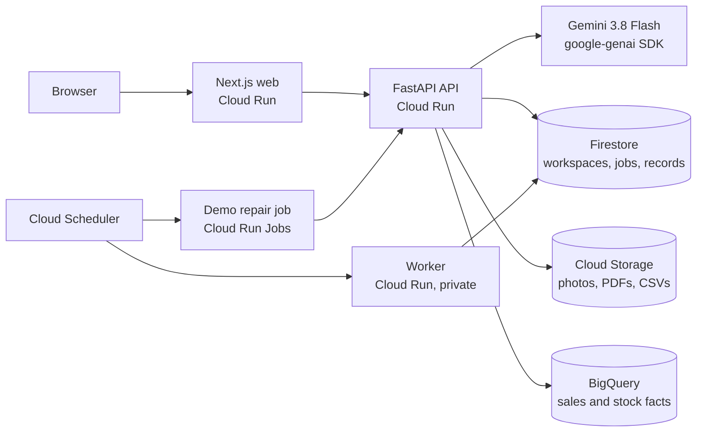

# StoreOps AI

**StoreOps finds why a promotion is failing in a store, helps the field rep fix it, and verifies the fix from shelf photos.**

Brands pay retailers for shelf placement during promotions, but nobody can easily tell whether the shelf actually looks the way the agreement says. StoreOps reads the agreement, turns it into checkable rules, looks at the store's sales and stock, inspects shelf photos with Gemini, proposes a fix, and only closes the issue when a new photo proves every rule passes.

| | |
|---|---|
| **Live app** | https://storeops-web-967137522464.asia-southeast1.run.app |
| **Demo video** | [youtu.be/KR8Y7qN2x9w](https://youtu.be/KR8Y7qN2x9w) (3:14) |
| **Deck (PDF)** | [docs/StoreOps_AI_deck.pdf](docs/StoreOps_AI_deck.pdf) |
| **Theme** | Retail & Commerce: Intelligent Customer and Business Experiences |
| **Team** | Nikolay Bandura, Ashley Bandura |

## Judge path (no sign-in needed)

1. Open the live app. You land on the home page with two buttons.
2. **See a completed example.** This is an investigation that already ran: the AI hypothesis, the evidence it cited (shelf photo, sales trend, back-room stock), the corrective actions, and two verifications. The first verification failed because only 2 of the 6 required facings were on the shelf. The second passed.
3. **Try it yourself.** Open the other store visit and click **Trigger AI Investigation**. Gemini looks at the shelf photo and the sales data and explains what is wrong, with citations.
4. Accept the plan, open **Verify execution**, and pick **Use sample photo: still not fixed**. The verifier fails the facing rule. Try again with **Use sample photo: fixed** and the issue closes.
5. Open **Promotions** to see the agreement PDF and the approved rules (REQUIRED_PRODUCT and MIN_FACINGS = 6) that every check is measured against.

The demo uses an invented brand (AquaPure), an invented agreement and AI-generated shelf photos. No real company data is used.

## How it works

1. **Agreement to rules.** Gemini reads the agreement PDF and proposes rules, each with the page and quote it came from. A person approves them. The model never approves its own rules.
2. **Investigation.** For a store visit, the Investigator agent combines the shelf photo, sales and stock for the promotion window, and the approved rules. Metrics such as the sales drop are computed in code, not by the model. The model's job is to explain them and cite the evidence.
3. **Plan.** The agent proposes corrective actions (for example, move back-room stock to the shelf). A person accepts them.
4. **Verification.** The rep uploads an after photo. The Execution Verifier checks every rule against it. The issue closes only when every rule passes. After photos must be taken within the last 30 minutes and must differ from the before photo.

Every model output is validated against a JSON schema (`contracts/ai-output.schema.json`) before the app uses it. A model call never changes business data directly.

## Architecture (what runs today)



- **AI:** Gemini (`gemini-3.8-flash`) through the `google-genai` SDK is the only AI model in the app at runtime. It handles the PDF rule extraction, the shelf photo analysis, the investigation reasoning and the verification. The demo's shelf photos were generated separately with Gemini's image model.
- **Google Cloud:** Cloud Run (web, API, private worker, repair job), Firestore, Cloud Storage, BigQuery and Cloud Scheduler, all in `asia-southeast1`.
- **Security:** browser code never reaches Firestore, BigQuery or Gemini directly. Firestore security rules deny all client access, and every request goes through the API, which checks workspace membership.

## Run it locally

Prerequisites: Python 3.11+ with [`uv`](https://docs.astral.sh/uv/), Node.js 20+ with `pnpm`, and a Gemini API key.

```bash
cp .env.example .env.local      # set GEMINI_API_KEY
uv sync
pnpm install
uv run uvicorn apps.api.main:app --reload --port 8000
pnpm --filter web dev           # http://localhost:3000
```

Load the demo data into a workspace through the public API:

```bash
uv run python -m scripts.seed_demo.seed --api-url http://127.0.0.1:8000 \
  --workspace-id <workspace-uuid> --token demo-admin [--with-ai]
```

Tests:

```bash
make test                 # backend unit, contract and integration tests
pnpm --filter web test    # web tests
make verify-spec          # spec and contract consistency
```

## Limits (honest list)

- The public demo has no sign-in: every visitor shares one demo account, which is an admin. A scheduled job restores missing demo records, but only after 2 hours with no activity, and it never edits or deletes anything a visitor changed.
- The API runs as a single instance. Records are kept in memory and written through to Firestore on every change, then reloaded at startup. Running more than one instance would need native Firestore repositories.
- Background work runs inside the API request today. The worker and Cloud Tasks path in the spec is not wired up yet.

## Specification

This project was built spec-first: product requirements, architecture, domain model, workflows, UI and AI behavior are in [`specs/`](specs), and the public API contract is in [`contracts/openapi.json`](contracts/openapi.json). Tasks and acceptance cases are in [`plan/`](plan).

| File | Purpose |
|---|---|
| [specs/00-product.md](specs/00-product.md) | Required behavior and the definition of a complete MVP |
| [specs/01-architecture.md](specs/01-architecture.md) | Target architecture, profiles and adapter interfaces |
| [specs/05-ai.md](specs/05-ai.md) | The two agents, tools, grounding and model settings |
| [specs/06-quality.md](specs/06-quality.md) | Tests, live evaluations and release gates |
| [contracts/SEMANTICS.md](contracts/SEMANTICS.md) | Cross-field validation and rule semantics |
| [DECISIONS.md](DECISIONS.md) | Architectural decisions |

### For AI coding agents

Development used AI coding assistants. If you are one, read [AGENTS.md](AGENTS.md) first: it holds the working procedure, ownership rules and contract-freeze policy.

## License

[MIT](LICENSE)
